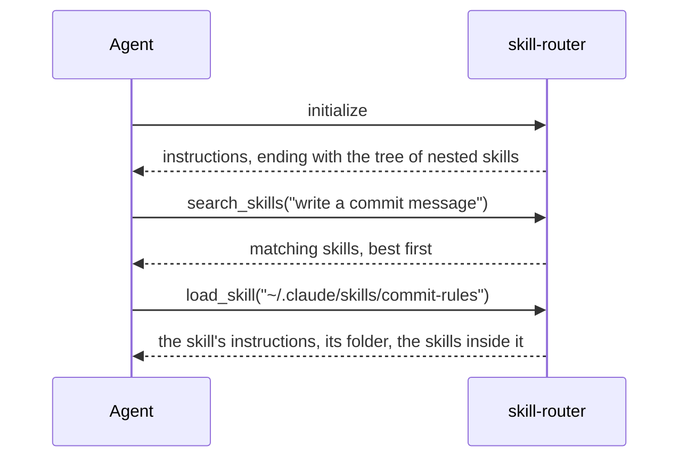

# skill-router

An MCP server that finds the skills for a request among every installed skill source, for any
agent reading the [Agent Skills](https://agentskills.io) format. An agent's skill listing costs
tokens on every skill in every session, and Claude Code lists no skill stored inside another
skill's folder; the router lets the agent search all of them and load the one a task needs.



## Tools

| Tool | Takes | Returns |
|---|---|---|
| `search_skills` | `query` - the task in a few English words; `limit` - 1 to 20, 10 by default | the best matching skills, best first: each name once, then the folder and description of every skill of that name |
| `load_skill` | `path` - a skill's folder, or the path of its `SKILL.md` | the skill's instructions without the frontmatter, its folder, and the nearest skills stored inside that folder |

A search for `commit message` returns:

```
commit-rules
  ~/.claude/skills/commit-rules
  Apply when writing commit messages
```

A load of `~/.claude/skills/mobile` returns:

```
Skill folder: ~/.claude/skills/mobile

<the instructions of mobile>

Narrower skills inside this one:
kite-switches
  ~/.claude/skills/mobile/kite-switches
  Apply when a Kite flag is switched
```

`load_skill` answers only a path that resolves to a skill the index holds. Unlike Claude Code's
Skill tool, it substitutes no `$ARGUMENTS` or `${CLAUDE_SKILL_DIR}` and grants no `allowed-tools`.

## Nested skills

The server's instructions end with the tree of the skills stored inside other skills' folders, so
the agent picks one at any depth and loads it without loading the skill above it:

```
Below is the tree of skills stored inside other skills' folders. Each line is a folder inside the
folder above it. To load a skill, pass load_skill the path down to its line, for example
~/.claude/skills/documents/lumen-brief.

~/.claude/skills
  documents
    lumen-brief
    pdf-forms
  mobile
    builds/ios-signing
    kite (skill kite-store)
      kite-audit
```

| Case | In the tree |
|---|---|
| a skill inside another skill's folder, at any depth | under it, one level of indent per skill |
| a folder named other than its skill | `kite (skill kite-store)` |
| folders between two skills that hold no skill | joined on one line: `builds/ios-signing` |
| a folder linked into a skill's folder, which no root's folders hold | under that skill, by the name of the link |
| a skill several links lead to | once: at its own folder where a root holds it, else at the first link in name order |
| a folder whose `SKILL.md` the index leaves out, or a skill hidden by one of the same name | part of the path to the skills below it |
| a root folder that is itself a skill | `~/skills (skill name)` on the root's line |
| a tree longer than `SKILL_ROUTER_INSTRUCTIONS_LIMIT` | deepest levels cut first: `area (3 more skills inside; load it to list them)` |
| no skill inside another | no tree |
| a skill added while the session runs | missing from the tree until the next session; the search finds it at once |
| a tree that fails to build | instructions without it |

## Search

| A skill is found by | Example |
|---|---|
| the words of its name, description and instructions, each counted once | a term only its instructions use still finds it, ranked below a skill writing it in its description |
| a word fewer skills write, ranked higher | a word one skill writes outranks a word most skills write |
| its name before its description, its description before its instructions | |
| an abbreviation of software work and its full form alike | `PR` and `pull request`, `CI` and `continuous integration`, `k8s` and `Kubernetes`; the list: `src/abbreviations.js` |
| a query in the language its description is written in | the agent writes English queries; Chinese or Japanese text matches only as a whole unbroken run |

The articles, conjunctions and prepositions of a query are not searched. Several skills of one
name - a copy installed for two agents, an older version in `skills/v1` - form one result, the
folder and description of each listed so the agent picks by both; copies sharing a description show
it once.

## Settings

| Setting | Effect |
|---|---|
| folders given as arguments to `server.js` | replace the default folders of [Where it looks](#where-it-looks) |
| `SKILL_ROUTER_INSTRUCTIONS_LIMIT` | the characters of the instructions; the tree is cut to fit, and kept whole when it is not set |

## Where it looks

| Agent | Folders |
|---|---|
| Claude Code | `$CLAUDE_CONFIG_DIR/skills` (`~/.claude/skills`) without its `synced` folder |
| | `synced/<organization>_<account>` in it, the claude.ai skills of the account read from `oauthAccount` in `$CLAUDE_CONFIG_DIR/.claude.json` (`~/.claude.json`) |
| | `<project>/.claude/skills` |
| | the `skills/` folder of every plugin Claude Code loads, and the folders its `plugin.json` key `skills` names; a project plugin only in its project |
| Codex | `$CODEX_HOME/skills` (`~/.codex/skills`) and its `.system` folder |
| | `.agents/skills` and `.codex/skills` in the project and every folder above it up to its git root |

The project is `$CLAUDE_PROJECT_DIR`, or the folder the server starts in.

| Order and precedence | |
|---|---|
| results of equal rank | the user's skills, then the project's, the plugins', and last those Codex ships |
| a `<project>/.claude/skills` skill named as one in `$CLAUDE_CONFIG_DIR/skills` | left out, as Claude Code hides it |

## What the walk reads

Every call walks the folders again, so a skill added or removed is found by the next call.

| Item | Read as |
|---|---|
| a folder whose name starts with a dot (`.git`, `.trash`), `node_modules` | skipped |
| a link to a folder | followed after the folders of every root; each folder is read once, so a link cycle ends |
| a `SKILL.md` larger than 1 MiB | left out |
| a `SKILL.md` that links to a file | a skill of the folder holding the link |
| a frontmatter with no name | the folder's name |
| a frontmatter with no description, or none | the first line of the instructions |
| a `SKILL.md` unchanged in time and size since the last call | not read again |
| a path inside the home folder | shown from `~`; `load_skill` takes it so |

## Installation

Node.js 20 or later. The server has no dependencies.

### Claude Code

```sh
claude plugin marketplace add ssoft-ai/marketplace
claude plugin install skill-router@ssoft-ai
```

| The plugin | |
|---|---|
| loads both tools | into every session |
| reminds the agent | on each request, to search the skills in English words before any other tool |
| shows in the console | the names a search found, or that it found none, and the skill loaded; the model's context does not receive these notices |
| sets `SKILL_ROUTER_INSTRUCTIONS_LIMIT` | to the characters Claude Code passes of a server's instructions: 4096, or as many as `CLAUDE_CODE_MAX_MCP_DESCRIPTION_LENGTH` sets |
| option `skill_names_only`, on by default | lists every skill, plugin skills included, by its name alone, so descriptions no longer fill the context and the search chooses the skill |

`skill_names_only` sets `skillListingMaxDescChars` to 1 in `<project>/.claude/settings.local.json`
while a session of the project runs, unless a settings file of the session sets that key or
`skillListingBudgetFraction`; the last session of the project to end removes the key, and the file
and the `.claude` folder where the plugin created them. A prompt given on the command line, as
`claude -p` gives it, may reach the model before the value is read.

| Limit of `skill_names_only` | What it leaves |
|---|---|
| a session killed before its `SessionEnd` event | the key, until the next session of that project ends; once the plugin is uninstalled, the key stays until removed from that file by hand |
| a session whose router server fails to start | every skill listed by name with nothing to search them, since the hook runs before the server connects |

### Codex

```sh
git clone https://github.com/ssoft-ai/skill-router.git
codex mcp add skill-router -- node <clone>/server.js
```

### Another MCP client

Register a local server started by `node <clone>/server.js` over standard input and output.

## Checks

| Command | Checks |
|---|---|
| `node --test` | the units, and the ranking of the queries an agent wrote for the skills of `test/fixtures/catalog/` |
| `evals/README.md` | whether Claude Code on Haiku loads a skill its listing does not show |

## Licence

[MIT](LICENSE.md).
