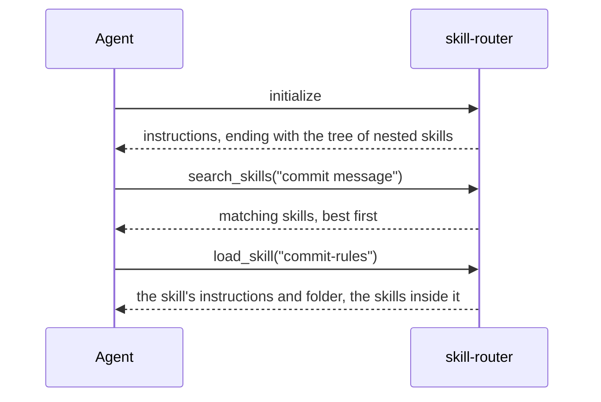

# skill-router

An agent that reads [Agent Skills](https://agentskills.io) keeps the installed skills'
descriptions in its context, in every session, so each skill added costs context before any work
starts. Claude Code also shows no skill stored inside another skill's folder.

skill-router is an MCP server that lets the agent search the installed skills by the words of its
task and load only the ones it needs, nested ones included. Under Claude Code its plugin also lists
the skills by name alone, which is where the context is saved; under another client the router
adds the search and the nested skills.

## Installation

Node.js 20 or later; nothing else.

### Claude Code

```sh
claude plugin marketplace add ssoft-ai/marketplace
claude plugin install skill-router@ssoft-ai
```

The plugin loads both tools into every session, reminds the agent on each request to search the
skills before any other tool, and shows in the console which skills were found and loaded.

Its option `skill_names_only`, on by default, lists every skill by its name alone, unless the
project's settings already set `skillListingMaxDescChars` or `skillListingBudgetFraction`. It
writes that key into `<project>/.claude/settings.local.json` while a session of the project runs.

| Case | Effect |
|---|---|
| a session killed before it ends | the key stays until the next session of the project ends, or, once the plugin is uninstalled, until it is removed by hand |
| the router fails to start | skills stay listed by name with nothing to search them; turn the option off in the plugin's options |

### Codex

```sh
git clone https://github.com/ssoft-ai/skill-router.git
codex mcp add skill-router -- node <clone>/server.js
```

Codex starts the server and receives both tools; the router has not been checked with a model
under Codex.

### Another MCP client

Register a local server started by `node <clone>/server.js` over standard input and output.

## How it works



- `search_skills` takes the task in a few English words and returns the matching skills, best
  first, each with its folder and description.
- `load_skill` takes a folder from a search, a load or the tree, and returns the skill's
  instructions, its full folder, and the skills stored inside it; it loads nothing but an
  installed skill.
- The server's instructions end with the tree of skills stored inside other skills' folders, so
  the agent can load a nested skill a search did not find.

The agent's own skill loading keeps working beside the router. The router's own cost is the
descriptions of its two tools, its instructions with the tree, at most 4096 characters under the
plugin by default, and the reminder on each request.

## Search

| A skill | |
|---|---|
| ranks by the words of the query in its name, description and instructions | in that order of weight; a word few skills write weighs more |
| is found by an abbreviation or its full form alike | `PR` and `pull request`, `k8s` and `Kubernetes` |
| written in another language | is found only by the English words it contains; the agent writes English queries |

## Where it looks

| Skills of | Folders |
|---|---|
| Claude Code | `~/.claude/skills` (`$CLAUDE_CONFIG_DIR/skills`), the claude.ai skills of the account included |
| | `<project>/.claude/skills` |
| | the skills of every plugin Claude Code loads |
| Codex | `~/.codex/skills` (`$CODEX_HOME/skills`) and its `.system` folder |
| | `.agents/skills` and `.codex/skills` in the project and every folder above it up to its git root |

All of them are read, whatever the agent. The project is `$CLAUDE_PROJECT_DIR`, or the folder the
server starts in. Each call reads the folders again, so a new skill is found at once. A project
skill named as one of the user's own is left out, as Claude Code hides it.

## Limits

- A skill sharing no word with the query is reached only through the agent's own listing, the
  tree, or a load of the skill holding it.
- `load_skill` returns a skill's text: it substitutes no `$ARGUMENTS` or `${CLAUDE_SKILL_DIR}`, for
  which the full folder it returns stands, and applies none of the frontmatter settings, such as
  `allowed-tools` or `model`, that Claude Code's own Skill tool applies.

## Settings

| Setting | Effect |
|---|---|
| `skill_names_only` | the Claude Code plugin's option, see [Claude Code](#claude-code) |
| folders given as arguments to `server.js` | replace the folders of [Where it looks](#where-it-looks) |
| `SKILL_ROUTER_INSTRUCTIONS_LIMIT` | the most characters of the instructions; the tree is cut from its deepest levels to fit, and kept whole when unset |

## Licence

[MIT](LICENSE.md).
