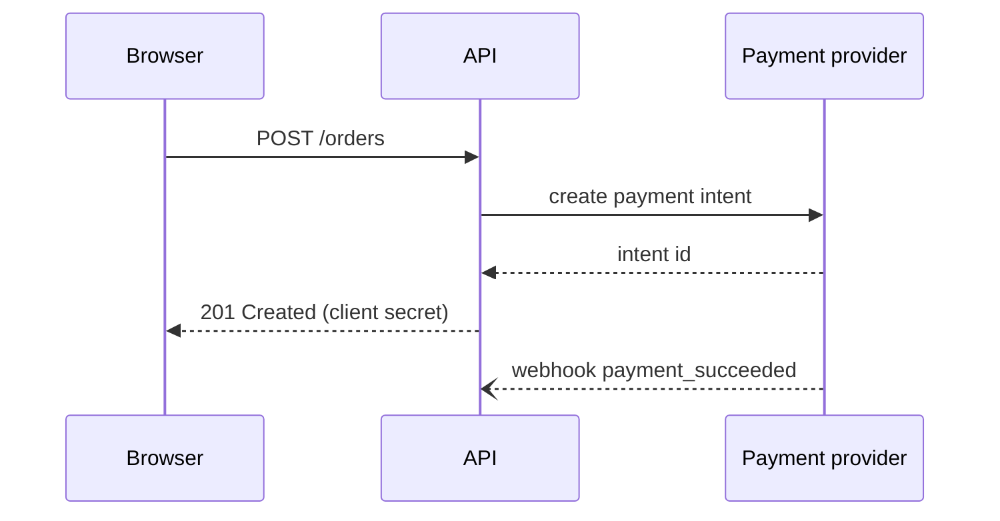

# Diagramming

Apply this skill when a design, a flow or an interaction needs a picture that is versioned with the code and can be changed in a pull request.

## Choose the diagram

| Question the reader has | Diagram |
|---|---|
| What are the parts and who talks to whom? | C4 context or container diagram |
| In what order do messages pass between parts? | sequence diagram |
| What happens step by step, with decisions? | flowchart or activity diagram |
| What states can this object be in? | state diagram |
| How is the data structured? | entity-relationship diagram |
| When does each piece of work happen? | Gantt chart |

One diagram answers one question at one level of detail. If you are tempted to show everything, draw two.

## Tools

- Mermaid: renders natively in GitHub, GitLab, Azure DevOps wikis and many Markdown tools; good for flowcharts, sequence, state, ER, Gantt and C4 (experimental). Preview with the Mermaid Live Editor or `mmdc` from `@mermaid-js/mermaid-cli`.
- PlantUML: richer UML, the C4-PlantUML library, finer layout control; needs a Java renderer or a PlantUML server.
- Structurizr DSL: one model, many C4 views.
- Graphviz DOT and D2 for graphs with automatic layout.

## Example (Mermaid sequence)

## Rules

- Title every diagram and state its scope and date or version.
- Label every arrow with what flows (request, event, file) and, for system diagrams, the protocol (HTTPS, gRPC, AMQP).
- Use the names that appear in the code and the deployment, not nicknames.
- Show trust boundaries and external systems distinctly.
- Keep it to roughly a dozen boxes; split by level beyond that.
- Add a legend when shapes or colours carry meaning; do not rely on colour alone.
- Store the source (`.mmd`, `.puml`, `.d2`) next to the document that uses it; commit rendered SVG only if the viewing platform cannot render the source.

## Pitfalls

- Diagrams in a binary drawing file (Visio, a draw.io export without the XML) that nobody can diff or update.
- Arrows whose direction is ambiguous - does it show the call or the data flow? Pick one and say so.
- Layout fights in Mermaid; reorder declarations or switch direction (`LR` vs `TB`) rather than adding invisible nodes.
- Diagrams that drift from reality; link them from the code area they describe so reviewers notice.

Diagrams in a threat model follow threat-modelling. Pictures for a talk go into slide-decks, and a project's overview diagram is placed by readme-writing.
